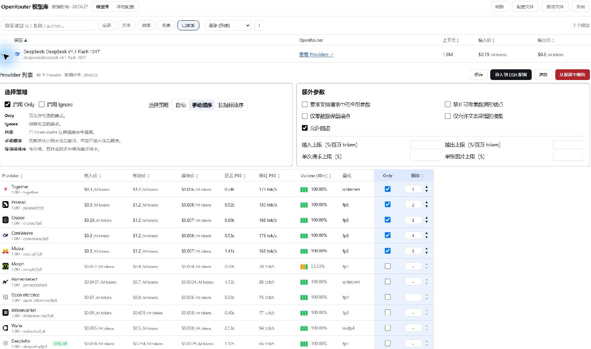

# DSH-openrouter-market

English | [中文](README.md)

An official-format **DeepSeek Harness plugin bundle** that adds an **OpenRouter model hub** to DSH Settings → Models: browse the live OpenRouter catalogue with per-provider pricing, quantization and availability, save per-model routing strategies, and merge picked models into DSH's OpenRouter model configuration.

The repository ships the built bundle (`lib/index.js`, `lib/client.js`); there is no build step, so an install is immediately runnable.



## Compatibility

- Target runtime: DSH 0.2.x, using the official plugin-package model (`dsh.bundle.patch` + `dsh.client`); metadata and loading paths validated against DSH Desktop `0.2.2-rc.1` and `@deepseek-ai/dsh` CLI `0.2.0-rc.2`.
- Runtime dependencies: none. The Host half uses Node built-ins only; the Client half takes `react` from the page's module table.
- Node.js ≥ 20.18.0.

## Install

1. In DSH Desktop, open **Plugins → Add plugin**.
2. Choose **npm registry**, enter `dsh-openrouter-market`, and select **Install**.
3. Quit and restart DSH, then open **Settings → Models**.

Installation by package name will be available after the package is published to the public npm registry. Before then, use the GitHub option in the same installer and enter `https://github.com/greatZhaoFD/dsh-openrouter-market.git`. Choose one installation method.

## Usage

1. **Configure your OpenRouter API key.** In DSH, go to **Settings → Models → Add model provider**, choose OpenRouter, and save your API key. If you already have an `openrouter` provider, edit it instead. By default the plugin reads the `OPENROUTER_API_KEY` DSH credential.
2. **Manage the model list through the plugin.** When first switching over, clear the preselected models under **Available models** in DSH's built-in OpenRouter provider settings. Keep the provider and its API key, then use the plugin to import the models you want. You can review imported models in the plugin's local configuration tab.
3. **Import the models you need.** Open **OpenRouter Models** at the bottom of **Settings → Models**. Find a model and expand it using the arrow on the left. Compare provider prices, latency, throughput, and uptime, then choose **Import to DSH config** for that model. It will appear in the DSH model picker.
4. **Configure routing if needed.** Expand a model, set `Only`, `Ignore`, manual ordering, or metric sorting, and choose **Save**. In the local configuration tab, expand an imported model to review its saved strategy or choose **Test route**. The test sends a live request and shows the provider that answered.

## Configuration

Defaults come from `cordis.patch.yml`; override the row with the same `id` in a profile `cordis.patch.yml` if needed (an override replaces the whole `config`, so write every field you need):

| Field | Default | Meaning |
| --- | --- | --- |
| `apiBaseUrl` | `https://openrouter.ai/api/v1` | OpenRouter API root (change only for a compatible proxy). |
| `apiKeyEnv` | `OPENROUTER_API_KEY` | Credential name DSH supplies; the key itself stays in DSH. |
| `modelsTtlMs` | `21600000` (6 h) | Model catalogue cache lifetime. |
| `endpointsTtlMs` | `900000` (15 min) | Provider/endpoint cache lifetime. |
| `timeoutMs` | `25000` | Per-request timeout against OpenRouter. |
| `enableRouting` | `true` | Inject saved routing strategies into chat requests (global `fetch` wrapper, fails safe). On by default; set `false` to skip the wrapper entirely. |

### Credentials

Configure the OpenRouter API key in DSH's provider settings (credential management) under the name matching `apiKeyEnv` (default `OPENROUTER_API_KEY`). The package contains the name only, never a key.

### Data locations

- Plugin storage: `$DSH_HOME/storages/openrouter-models/` (`routing.json`, boot marker `host-alive.json`, icon cache).
- Config backups: `$DSH_HOME/config_backups/openrouter-models/`.
- `$DSH_HOME` defaults to `~/.dsh`.

### Where routing lives

Routing strategies are **not** written into the `llm-pi-ai` YAML: DSH's model configuration schema only carries the model list, not OpenRouter's `provider` routing fields. The plugin keeps them in its own store and injects them at request time:

```text
$DSH_HOME/storages/openrouter-models/routing.json
```

It is keyed by model id, written with two-space indentation and a trailing newline so it can be read and diffed by hand (minified files written by older versions are reformatted once when loaded):

```json
{
  "version": 1,
  "updatedAt": "2026-11-10T15:08:12.345Z",
  "strategies": {
    "deepseek/deepseek-v4.1-flash-1017": {
      "routingVersion": 2,
      "mode": "custom",
      "order": ["deepinfra", "together", "fireworks"],
      "allowFallbacks": true,
      "enabled": true
    }
  }
}
```

A strategy applies when the request is a `POST`, the host equals `apiBaseUrl`'s host, the path ends with `/chat/completions` or `/messages`, and the body's `model` equals the strategy key. `mode: custom` maps `order` to `provider.order`; `sort`, `only`, `ignore`, `quantizations`, `max_price`, `require_parameters`, `data_collection`, `zdr` and `allow_fallbacks` map to the same OpenRouter fields. Explicit caller `provider` fields win, except a `sort` conflict, where the strategy wins and a warning is logged.

Health: `http://127.0.0.1:<port>/api/openrouter-models/routing/status` reports `configEnabled: true` and an `injected` counter that grows after chats; `/api/openrouter-models/routing` lists every strategy.

To verify routing and the serving provider: `http://127.0.0.1:<port>/api/openrouter-models/probe?model=<model id>` sends a one-token request with the saved strategy and returns `provider` (the provider that served it), `appliedProvider` (the injected provider object) and `usage`. The panel's **Test route** button calls the same endpoint.

## Upgrade and uninstall

- GUI: update or remove the installed bundle on the Plugins page, then restart DSH.
- CLI:

  ```powershell
  dsh plugin --profile web remove dsh-openrouter-market
  ```

Disabling the plugin never edits unrelated profile configuration.

## Troubleshooting

| Symptom | Check |
| --- | --- |
| No entry at the bottom of Settings → Models | Is the bundle enabled, and did Desktop fully restart? The Client bundle loads at process start. |
| Empty model list or 401 | Is `OPENROUTER_API_KEY` present in DSH credentials with the same name as `apiKeyEnv`? |
| Is the Host half alive? | `$DSH_HOME/storages/openrouter-models/host-alive.json` (`stage` / `mounted`), or `http://127.0.0.1:<port>/api/openrouter-models/status`. |
| Verify routing and the provider | Click **Test route** for the model (or open `/api/openrouter-models/probe?model=<model id>`) and read `provider`; cross-check against OpenRouter's Activity page. |

## Development

The repository commits its built artifacts, so there is no build step. Validate consistency after edits:

```powershell
npm test            # zero-dependency smoke checks: manifest / patch / artifacts / plugin index
npm run pack:check  # inspect the npm tarball contents
```

Release: push a tag; GitHub Actions validates, runs `npm pack`, and attaches the `.tgz` to the Release.

## License

MIT — see [LICENSE](LICENSE).
