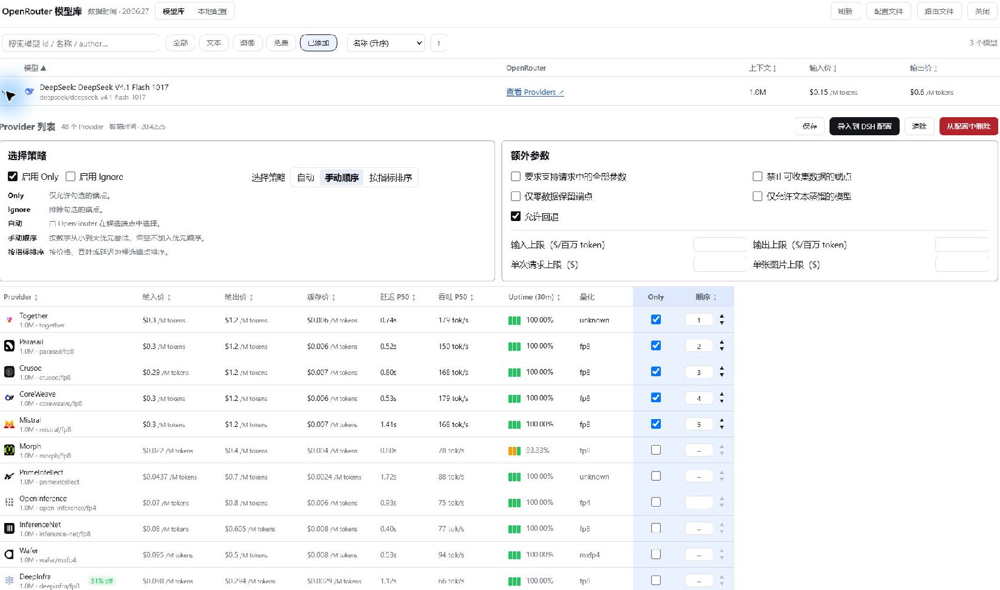

# DSH-openrouter-market

[English](README.en.md) | 中文

在 DeepSeek Harness 的「设置 → Models」页底部提供「OpenRouter 模型库」：浏览 OpenRouter 实时模型目录与各家 Provider 的价格 / 量化 / 可用性，保存分模型路由策略，并按模型导入到 DSH 的 OpenRouter 模型配置。

本仓库同时是插件的发布仓库：仓库包含的是已构建产物，没有构建步骤，安装后即可运行。



## 兼容性

- 目标运行时：DSH 0.2.x（`dsh.bundle` + `dsh.client` 官方插件包模型；在 DSH Desktop `0.2.2-rc.1`、`@deepseek-ai/dsh` CLI `0.2.0-rc.2` 上校验元数据与加载路径）。
- 运行时依赖：无。Host 侧只用 Node 内置模块，Client 侧只从页面模块表取 `react`。
- Node.js ≥ 20.18.0。

## 安装

1. 在 DSH 桌面端打开 **插件 → 添加插件**。
2. 选择 **npm registry**，输入 `dsh-openrouter-market`，点击 **安装**。
3. 完全退出并重新启动 DSH，再打开 **设置 → 模型**。

按包名安装需要等插件发布到公开 npm registry。发布前可在同一个安装入口选择 GitHub，输入 `https://github.com/greatZhaoFD/dsh-openrouter-market.git`。任选一种方式安装即可。

## 使用

1. **配置 OpenRouter API Key。** 在 DSH 的 **设置 → 模型 → 添加模型提供商** 中选择 OpenRouter，填入你的 OpenRouter API Key 并保存。如果已经有 `openrouter` 提供商，直接编辑该条目即可。插件默认读取 DSH 凭据 `OPENROUTER_API_KEY`。
2. **把模型清单交给插件管理。** 首次切换时，建议在 DSH 原生的 OpenRouter 提供商设置中取消勾选「可用模型」里预选的模型，并保留提供商和 API Key。然后用插件导入实际需要的模型。已经通过插件导入的模型可以在插件的「本地配置」里查看。
3. **导入需要的模型。** 在 **设置 → 模型** 底部打开 **OpenRouter 模型库**，搜索模型并点左侧箭头。展开后可查看各 Provider 的价格、延迟、吞吐和可用性。点击该模型的 **导入到 DSH 配置**，之后就可以在 DSH 的模型选择器中使用它。
4. **按需配置路由。** 在模型展开区设置 `Only`、`Ignore`、手动顺序或指标排序，然后点 **保存**。在 **本地配置** 页展开已导入的模型，可以查看已保存策略并点 **测试路由**。测试会发送一条真实请求，弹窗显示这次实际响应的 Provider。

## 配置

插件配置由 `cordis.patch.yml` 的默认值提供，可在 profile 的 `cordis.patch.yml` 里用同 `id` 覆盖（**覆盖会替换整个 `config`**，请把需要的字段都写全）：

| 字段 | 默认值 | 说明 |
| --- | --- | --- |
| `apiBaseUrl` | `https://openrouter.ai/api/v1` | OpenRouter API 根地址，仅兼容代理时才改。 |
| `apiKeyEnv` | `OPENROUTER_API_KEY` | DSH 凭据名；密钥本身由 DSH 凭据管理保存，插件只读这个名称。 |
| `modelsTtlMs` | `21600000`（6 小时） | 模型目录缓存时长。 |
| `endpointsTtlMs` | `900000`（15 分钟） | Provider / 端点数据缓存时长。 |
| `timeoutMs` | `25000` | 单次 OpenRouter 请求超时。 |
| `enableRouting` | `true` | 是否把已保存的路由策略注入聊天请求（全局 `fetch` 包装，失败自动回退）。默认开启；设为 `false` 可完全跳过该包装。 |

### 凭据

在 DSH 的 OpenRouter Provider 配置里填写 API Key（凭据管理），并让凭据名与 `apiKeyEnv` 一致，默认 `OPENROUTER_API_KEY`。发行包里只有凭据名称，不含任何密钥。

### 数据位置

- 插件存储：`$DSH_HOME/storages/openrouter-models/`（路由策略 `routing.json`、启动自检 `host-alive.json`、图标缓存）。
- 配置备份：`$DSH_HOME/config_backups/openrouter-models/`（导入模型前备份 profile patch）。
- `$DSH_HOME` 未显式设置时为 `~/.dsh`。

### 路由策略存放在哪

策略**不写进** `llm-pi-ai` 的 YAML：DSH 的模型配置 schema 只有模型清单，没有 OpenRouter 的 `provider` 路由字段。插件把策略存在自己的存储里，运行时注入请求：

```text
$DSH_HOME/storages/openrouter-models/routing.json
```

`routing.json` 按模型 id 保存，2 空格缩进、带结尾换行，可直接用编辑器阅读（旧版本写入的压缩格式会在插件加载时自动重排一次）：

```json
{
  "version": 1,
  "updatedAt": "2026-11-10T15:08:12.345Z",
  "strategies": {
    "deepseek/deepseek-v4.1-flash-1017": {
      "routingVersion": 2,
      "mode": "custom",
      "order": ["deepinfra", "together", "fireworks"],
      "only": [],
      "ignore": [],
      "allowFallbacks": true,
      "quantizations": [],
      "maxPrice": { "prompt": null, "completion": null, "request": null, "image": null },
      "requireParameters": false,
      "dataCollection": "allow",
      "zdr": false,
      "enforceDistillableText": false,
      "preferredMinThroughput": null,
      "preferredMaxLatency": null,
      "enabled": true
    }
  }
}
```

生效条件：请求是 `POST`、目标主机等于 `apiBaseUrl` 的主机、路径以 `/chat/completions` 或 `/messages` 结尾，且请求体里的 `model` 与策略的 key 完全一致。命中后 `mode: custom` 的 `order` 变成请求体的 `provider.order`，`sort` / `only` / `ignore` / `quantizations` / `max_price` / `require_parameters` / `data_collection` / `zdr` / `allow_fallbacks` 等按 OpenRouter 的同名字段注入；调用方自己写的 `provider` 字段优先，`sort` 冲突时以策略为准并打告警。

自检：`http://127.0.0.1:<端口>/api/openrouter-models/routing/status` 里的 `configEnabled` 应为 `true`，对话后 `injected` 计数增长；`/api/openrouter-models/routing` 可看全部策略。

验证路由与提供方：`http://127.0.0.1:<端口>/api/openrouter-models/probe?model=<模型 id>` 会用已保存策略发一条 1 token 的探测请求，返回 `provider`（实际提供方）、`appliedProvider`（本次注入的 provider 参数）与 `usage`。面板里的 **测试路由** 按钮调用的是同一个接口。

## 升级与卸载

- 图形界面：插件页对已安装 bundle 执行更新 / 卸载，然后重启 DSH。
- 命令行：先装新版再移除旧版，或直接卸下 bundle。

  ```powershell
  dsh plugin --profile web remove dsh-openrouter-market
  ```

- 插件被禁用后不会改动 profile 里的其它配置；卸载只会移除自己的 bundle 行与依赖。

## 排障

| 现象 | 检查 |
| --- | --- |
| 「设置 → Models」底部没有条目 | 插件是否已启用；桌面端是否已**完全退出并重启**（Client bundle 只在启动时加载）。 |
| 模型列表为空或 401 | `OPENROUTER_API_KEY` 是否已在 DSH 凭据管理中配置，名称与 `apiKeyEnv` 是否一致。 |
| 想确认 Host 半区是否激活 | 看 `$DSH_HOME/storages/openrouter-models/host-alive.json` 的 `stage` / `mounted` 字段，或本机访问 `http://127.0.0.1:<端口>/api/openrouter-models/status`。 |
| 想确认路由策略是否生效 | 看 `routing.json` 里是否有该模型 id；`/api/openrouter-models/routing/status` 的 `configEnabled` 为 `true` 且 `injected` 增长；`skipped` 增长通常是模型 id 不匹配或路径不是 `/chat/completions`。 |
| 想确认实际是哪个 Provider | 面板里对该模型点 **测试路由**，或浏览器打开 `/api/openrouter-models/probe?model=<模型 id>`，看返回的 `provider`；也可以对照 OpenRouter 网站的 Activity 记录。 |

## 开发与校验

仓库里提交的是构建产物（`lib/index.js`、`lib/client.js`），因此**没有构建步骤**，克隆后即可安装。改动产物后跑一致性校验：

```powershell
npm test            # 零依赖冒烟校验：清单 / patch / 产物 / 插件索引
npm run pack:check  # 查看 npm 打包内容
```

发布流程：打标签并推送，GitHub Actions 会做校验、`npm pack` 并把 `.tgz` 附到 Release。

```powershell
git tag v0.2.1
git push origin v0.2.1
```

## 许可证

MIT，见 [LICENSE](LICENSE)。
